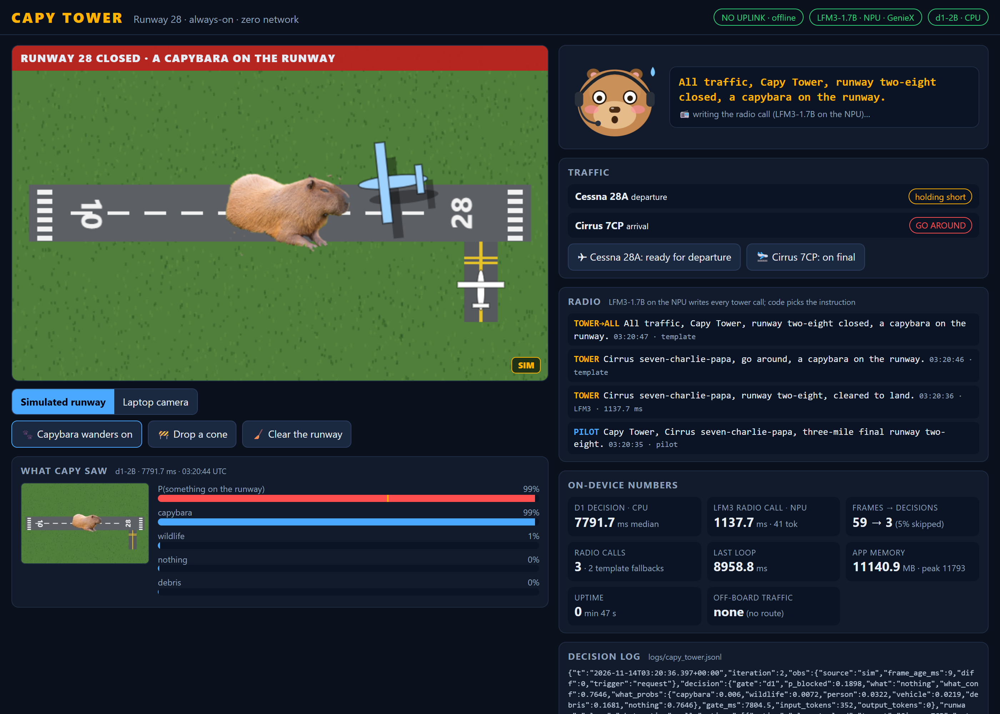
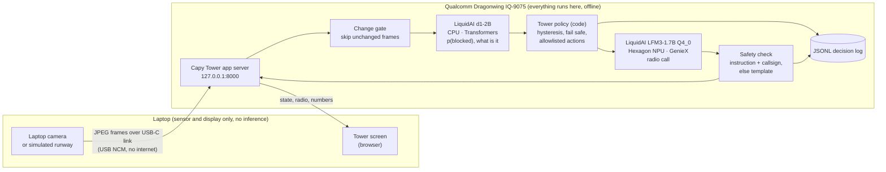
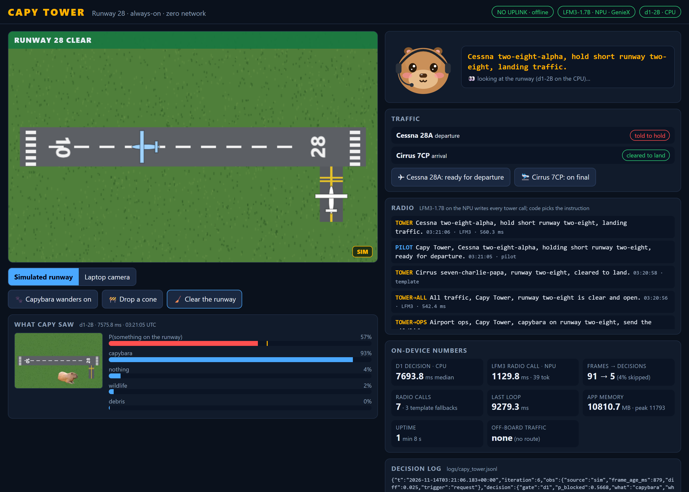

# Capy Tower 🐾✈️

**An offline AI control tower in a box, running entirely on a Qualcomm Dragonwing IQ-9075.**

Capy Tower watches a runway camera and, the moment a capybara (or a person, vehicle, or piece of debris) wanders onto the runway, it orders the landing aircraft to go around, closes the runway, and calls the wildlife crew. It talks to pilots in standard FAA phraseology, and once the runway is clear again it reopens it and clears waiting traffic on its own. LiquidAI's **d1-2B** decides what is on the runway and **LFM3-1.7B** on the **Hexagon NPU** writes every radio call. Nothing leaves the board: turn the Wi-Fi off and the tower keeps working.



*Live on the IQ-9075 with Wi-Fi off: d1-2B is 99% sure there is a capybara on the runway, the Cirrus is sent around, and the runway is closed.*

🎬 **Demo video (1:46, captioned):** [`docs/video/capy_tower_demo.mp4`](docs/video/capy_tower_demo.mp4). A screen recording of the real board running the full demo with its Wi-Fi off; the runway camera is the simulated feed. The narration voice was made with ElevenLabs for the video only; Capy Tower itself calls no outside service.

Team **chinese** · [@chinesepowered](https://x.com/chinesepowered) on X · *On-Device AI Hackathon: Cleared for Takeoff*, LiquidAI x Qualcomm, San Francisco, November 13, 2026

## The problem

On the afternoon of November 13, 2026, the day of this hackathon, a communications failure at the FAA grounded every departure in the United States. Air traffic safety depends on networks, and networks fail.

Meanwhile, most of the roughly 5,000 public airports in the US have **no control tower at all**. Nobody watches the runway when a deer, a dog, a loose cone, or a capybara wanders onto it, and pilots find out on short final. A cloud-vision fix does not work here: these airfields often have poor connectivity, streaming runway video all day costs money per call, and a safety system that depends on the network goes down exactly when the network does.

## Our solution

An **always-on local agent** that needs nothing but power:

1. **Watch.** A camera (or a simulated runway for the demo) streams frames to the board. A pixel-change gate skips frames where nothing moved, so the models stay idle on a quiet runway.
2. **Decide.** **d1-2B** answers typed questions about each changed frame in one forward pass: *is anything on the runway?* and *what is it?*
3. **Act.** Plain code turns that decision into tower actions from an allowlist: go around, cancel takeoff, close the runway, hold short, dispatch the wildlife crew, reopen, clear to land, clear for takeoff.
4. **Talk.** **LFM3-1.7B** on the NPU phrases each instruction as a radio call. A safety check makes sure the call says what the code decided, or a fixed template is sent instead. The board then says the call out loud on its own speaker in a **LiquidAI LFM3-Audio-2B** voice, rendered on the board (llama.cpp); the standard tower calls are pre-rendered at setup (`scripts/render_voice.py`) because live LFM3-Audio runs at about 0.45x real time on the CPU, with Piper as the fallback for anything new.
5. **Recover on its own.** When the runway clears, aircraft that were told to wait are cleared automatically, arrivals first.
6. **Log.** Every decision, action and radio call goes to `logs/capy_tower.jsonl` and the live tower screen.

**Why not a cloud API call?** Because the network is the failure mode. A go-around cannot wait for a round trip, an outage or a rate limit; the marginal cost of watching all day is zero; and runway video never leaves the airfield.

## Sponsor technology at a glance

| Sponsor | What we used | What it does in Capy Tower | Where it runs |
|---|---|---|---|
| **Qualcomm** | Dragonwing **IQ-9075** EVK (QCS9075, 36 GB LPDDR5, Ubuntu 24.04) | Hosts the entire system: both models, the agent loop, the web app and the log | The board |
| **Qualcomm** | **Hexagon NPU** (HTP v73) via **GenieX v0.10.0** (QAIRT 2.50) | Runs LFM3-1.7B for every radio call, about 0.6 s per call | NPU (`HTP0`) |
| **Qualcomm** | Kryo **CPU** (8 cores) | Runs d1-2B decisions through Transformers | CPU |
| **Qualcomm** | Board **USB-C port** as a USB network gadget | Isolated laptop link for the screen, so the demo works with Wi-Fi off | Board USB-C |
| **LiquidAI** | **LFM3-1.7B** (GGUF, QAD Q4_0) | The tower's voice: FAA-style radio calls | NPU |
| **LiquidAI** | **d1-2B** (LFM3 family decision model, built on LFM3-VL-2B) | The tower's eyes: is the runway blocked, and by what | CPU |

## Architecture



The browser never runs a model and talks only to the board, over an SSH tunnel on a direct USB-C cable. The app, both model servers and the log all bind to the board's loopback interface.

## Qualcomm: Dragonwing IQ-9075

**The board is the whole product.** We started from a freshly flashed IQ-9075 and set it up during the event (`scripts/board_setup.sh`):

- **Hexagon NPU through GenieX.** We installed the NPU packages (`qcom-fastrpc1`, `libqnn1`), gave the user access to `/dev/fastrpc-cdsp*`, installed **GenieX v0.10.0**, and serve LFM3-1.7B from its OpenAI-compatible server on `127.0.0.1:18181` with NPU compute. The server log confirms `Using 1 device(s): HTP0`. Every radio call is a capped, validated request to that local server: about **0.61 s end to end, 18 tokens**.
- **CPU for the decision model.** d1-2B runs in fp32 through Transformers on the 8-core Kryo CPU, the hackathon's verified d1 route. The NPU and CPU split the work: the NPU talks while the CPU looks.
- **36 GB of memory** holds both models with room to spare: the whole app uses about **12 GB**.
- **USB-C as the demo link.** The venue Wi-Fi isolated clients, and the laptop has no Ethernet port. We turned the board's USB-C port into a USB NCM network gadget (`scripts/usb_link.sh`): Windows 11 binds its inbox driver, both ends take link-local addresses, and the laptop reaches the board at `169.254.7.2` with no internet path at all. This is the isolated USB-C control link the judging rules allow.
- **Survives a reboot.** systemd units (`scripts/systemd/`) bring back the USB link, the GenieX server and Capy Tower at boot.
- **Offline proof.** The app reads `/proc/net/route` and shows **NO UPLINK · offline** when the board has no route out. We rehearsed the full demo with `nmcli radio wifi off`: every call still came from the NPU.

## LiquidAI: LFM3 family

**d1-2B, the eyes.** d1-2B is LiquidAI's decision model built on LFM3-VL-2B. Instead of generating text, it returns calibrated answers to typed questions in one forward pass with **zero output tokens**. Each changed frame gets two questions (`capy_tower/gates.py`):

- `blocked` (yes/no): *Is there an animal, a person, a vehicle or an object on the runway right now?*
- `what` (choice): capybara, other wildlife, person, vehicle, debris, or nothing.

On the board, the capybara frame scores **p(blocked) 0.99** and **capybara 0.99**; the empty runway scores **p(blocked) 0.05**. The tower closes the runway at p ≥ 0.6 and reopens at p ≤ 0.4, so it does not flap, and an uncertain first reading fails safe. Because d1 answers with probabilities rather than prose, the safety decision is a number that code can threshold, log and audit.

**LFM3-1.7B, the voice.** LFM3-1.7B (QAD Q4_0 GGUF, about 1 GB) writes each radio call in FAA phraseology from a short instruction prompt (`capy_tower/tower.py`). It never decides anything. Every call must:

- contain the required instruction ("go around", "hold short", "cleared to land"…),
- use the exact callsign ("Cirrus seven-charlie-papa"),
- name only runway 28,
- avoid contradicting words (a go-around may never say "cleared"),
- stay short, with no stray digit runs or request tags.

Otherwise the fixed template call is sent and the failure is logged. In our offline rehearsal, **11 of 11** generated calls passed. Reasoning is turned off for direct answers, and every request is capped and retried once, using the hackathon's `lfm_client.py`.

**Why two LFM3 models?** Each does the job it is built for: a single-pass decision model for the safety-critical judgement, and a small generator for natural language. The decision costs zero generated tokens, and the generator only runs when there is something to say.

## Measured on the IQ-9075

| Metric | Value |
|---|---|
| d1-2B decision, CPU fp32 (one frame, two questions, 352 input tokens) | 7.6 s median |
| d1-2B model load | 3.9 s |
| LFM3-1.7B radio call, NPU, end to end | 0.61 s median, 18 tokens |
| Generated calls passing the safety check (offline run) | 11 of 11 |
| App memory (RSS, includes d1 in fp32) | 11.9 GB of 36 GB |
| Off-board network calls | none (rehearsed with Wi-Fi off and no route) |

The 7.6 s decision is the slow part, and the change gate means it only runs when the picture changes. **Next step:** move d1 to the NPU with ZETIC's native `d1-2B-IQ9` package.

## The two-minute demo

1. Turn the board's Wi-Fi off in front of the judge: `sudo nmcli radio wifi off`. The header shows **NO UPLINK · offline**.
2. **Cirrus 7CP: on final**: *"Cirrus seven-charlie-papa, runway two-eight, cleared to land."*
3. **Capybara wanders on**: d1 flags it, then *"Cirrus seven-charlie-papa, go around, capybara on the runway."* The runway closes and the wildlife crew is called.
4. **Cessna 28A: ready for departure**: *"Cessna two-eight-alpha, hold short runway two-eight, a capybara on the runway."*
5. **Clear the runway**: the runway reopens and the Cirrus is cleared to land, with no further clicks.
6. Point at the decision log and the on-device numbers.



## Run it

On a fresh IQ-9075, while it has internet:

```bash
SUDO_PW=... scripts/board_setup.sh geniex   # NPU packages, GenieX v0.10.0, LFM3-1.7B Q4_0
scripts/board_setup.sh d1                   # d1 venv (CPU-only torch), pinned d1-2B snapshot
~/.local/bin/uv pip install --python ~/.venvs/d1/bin/python "transformers==5.19.0"
```

With GenieX serving (`skills/iq9-geniex-lfm/scripts/serve.sh run` from the [hackathon repo](https://github.com/heath0xFF/cleared-for-takeoff-hackathon)):

```bash
sudo scripts/usb_link.sh a600000.usb   # USB-C link to the laptop, board at 169.254.7.2
scripts/run_board.sh                   # Capy Tower on 127.0.0.1:8000
```

On the laptop, with a USB-C cable to the board's USB-C port:

```bash
ssh -N -L 127.0.0.1:8000:127.0.0.1:8000 ubuntu@169.254.7.2
```

Open `http://127.0.0.1:8000` and pick **Simulated runway** or **Laptop camera**.

Lessons from a fresh board: set the clock before HTTPS works; install CPU-only torch (the default aarch64 wheels pull gigabytes of CUDA libraries); pin Transformers 5.19.0 for d1-2B's bundled model code; and use the USB-C gadget link when the venue Wi-Fi isolates clients.

## Safety design

- **The language model never decides.** Code picks every instruction from the d1 decision; LFM3 only phrases it, and a checker enforces the content.
- **Fail safe.** Uncertain readings close the runway; hysteresis prevents flapping.
- **Allowlist.** Only ten named actions can execute; anything else is logged as refused.
- **Errors are data.** Failed decisions or radio calls are logged and the loop keeps watching.

## Repository map

| Path | What |
|---|---|
| `capy_tower/app.py` | The always-on loop and the board-hosted web server (standard library) |
| `capy_tower/gates.py` | d1-2B gate (Transformers, CPU) and the pixel-rule fallback |
| `capy_tower/tower.py` | Runway policy, traffic, allowlisted actions, radio prompts, templates and checks |
| `capy_tower/lfm_client.py` | Capped, validated GenieX client from the hackathon repo (MIT) |
| `capy_tower/static/` | The tower screen: plain HTML, CSS and JavaScript, no CDN |
| `scripts/board_setup.sh` | Fresh-board setup: NPU packages, GenieX, LFM3, d1 |
| `scripts/usb_link.sh` | Isolated USB-C network link (USB NCM gadget) |
| `scripts/run_board.sh` | Launcher with board checks |
| `scripts/systemd/` | Boot units for the USB link, GenieX and Capy Tower |
| `logs/capy_tower.jsonl` | Decision log from our rehearsal |
| `docs/arduino_project_hub.md` | Our Arduino Project Hub write-up |

Code: MIT (see `LICENSE`). Third-party material and model licenses: see `THIRD_PARTY.md`.
